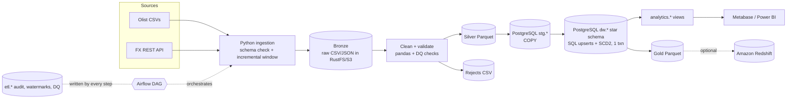

# Architecture

## Layers
| Layer | Where | Content |
|---|---|---|
| Bronze | `bronze/olist/<table>/run_id=…/` (bucket `ecom-lake`) | Raw rows of the incremental window, untouched strings; FX JSON |
| Silver | `silver/<table>/run_id=…/*.parquet`, `rejects/…` | Typed, standardised, deduplicated; failed rows quarantined with reason |
| Staging | `stg.*` (Postgres) | Latest silver batch (truncate+COPY) |
| Warehouse | `dw.*` | Star schema, SCD2 customers/products |
| Gold | `gold/<table>/run_id=…/` | Parquet snapshot of dw tables for BI/Redshift |
| Analytics | `analytics.*` views | KPIs |
| Monitoring | `etl.pipeline_runs`, `etl.step_log`, `etl.dq_results`, `etl.watermarks`, JSON logs | |

## Key design decisions
- **ELT split**: Python does row-level cleaning (pandas); set-based modelling (SCD2, upserts, aggregates) is SQL.
- **Idempotency**: facts use `INSERT … ON CONFLICT DO UPDATE` on the grain key; dimensions compare an attribute hash; staging is truncate+load; re-running a window changes nothing.
- **Incremental**: watermark = max `order_purchase_timestamp` loaded; next run reads `watermark − LOOKBACK_DAYS` onward (catches late status updates; overlap is harmless due to upserts). Watermark only advances after post-load checks pass and never moves backwards.
- **Atomic warehouse load**: all transform SQL runs in one transaction.
- **Failure isolation**: steps communicate via storage + manifest, so Airflow can retry any task alone. Audit rows commit on separate connections so failures are still recorded.
- **Unknown members** (`-1`) keep facts whole when a dimension key is missing; counted as warnings.
- **Why PostgreSQL warehouse + optional Redshift**: Postgres covers the full local path for free; Redshift is a serving target fed from gold Parquet (Redshift has no `ON CONFLICT`, so the same SQL is not reused there).
- **dbt not used**: the SQL scripts are the transformation layer; adding dbt would duplicate it.

## Local vs cloud
| | Local | Cloud (optional) |
|---|---|---|
| Object store | RustFS | Amazon S3 |
| Warehouse | PostgreSQL container | Redshift (serving) / RDS PostgreSQL |
| Orchestration | Airflow in Docker | MWAA or self-hosted |
| Secrets | `.env` | IAM roles / Secrets Manager |
| Monitoring | JSON logs + etl tables | CloudWatch |

## Known limitations
- Incremental window is keyed on purchase time; updates to very old orders (outside lookback) are not captured (production fix: source `updated_at` / CDC).
- Customer SCD2 version dates come from order purchase time; several address changes within one batch collapse into the latest.
- Gold -> Redshift is full refresh per run.
- Source "PostgreSQL" ingestion (OLTP DB extraction) is not implemented; sources are CSV + REST.
