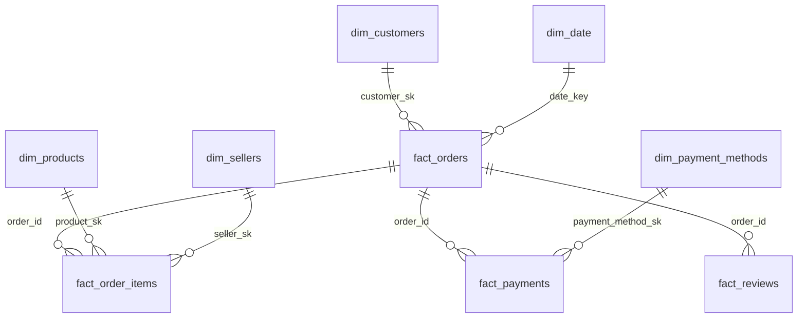

# Warehouse Schema (`dw`)

DDL: `sql/ddl/20_warehouse.sql`. Surrogate keys are `bigserial`; `-1` is the *Unknown* member of each dimension.

## Dimensions
| Table | Natural key | Surrogate key | History | Notes |
|---|---|---|---|---|
| dim_date | full_date | date_key (yyyymmdd) | static | 2015-2030 |
| dim_customers | customer_unique_id | customer_sk | **SCD2** (zip, city, state) | `valid_from/valid_to/is_current/attr_hash`; first version valid_from=1900-01-01; partial unique index = one current row |
| dim_products | product_id | product_sk | **SCD2** (category, weight, dims) | version effective at batch time |
| dim_sellers | seller_id | seller_sk | SCD1 | overwrite |
| dim_payment_methods | payment_type | payment_method_sk | static | |
| dim_geolocation | zip_code_prefix | – | SCD1 | one aggregated row per prefix |
| ref_fx_rates | (rate_date, base, quote) | – | upsert | from REST API |

Olist quirk: `customer_id` is per order; `customer_unique_id` identifies the person, hence the natural key choice.

## Facts
| Table | Grain | PK | FKs | Measures |
|---|---|---|---|---|
| fact_orders | 1 row / order | order_id | customer_sk, purchase/delivered/estimated date_key | item_count, items_value, freight_value, payment_value, review_score, delivery_days, delivery_delay_days, is_late |
| fact_order_items | 1 row / order line | (order_id, order_item_id) | order, product_sk, seller_sk, customer_sk, date_key | price, freight_value |
| fact_payments | 1 row / payment record | (order_id, payment_sequential) | order, payment_method_sk, date_key | payment_value, installments |
| fact_reviews | 1 row / (review, order) | (review_id, order_id) | order, creation date_key | review_score, has_comment |

Point-in-time joins: `fact.purchase_ts >= dim.valid_from AND fact.purchase_ts < dim.valid_to`.

Indexes: PKs, `fact_orders(customer_sk | purchase_date_key | order_status)`, `fact_order_items(product_sk | seller_sk | purchase_date_key)`, `fact_payments(payment_method_sk)`, `dim_*(natural key, valid_from, valid_to)`.

## Other schemas
- `stg.*` – one table per silver dataset (+ `_run_id`).
- `etl.pipeline_runs`, `etl.step_log`, `etl.watermarks`, `etl.dq_results`.
- `analytics.*` – v_kpi_summary, v_daily_sales, v_monthly_revenue (MoM, cumulative), v_monthly_revenue_usd, v_category_performance, v_seller_performance, v_customer_value, v_delivery_performance, v_payment_mix, v_pipeline_health.

